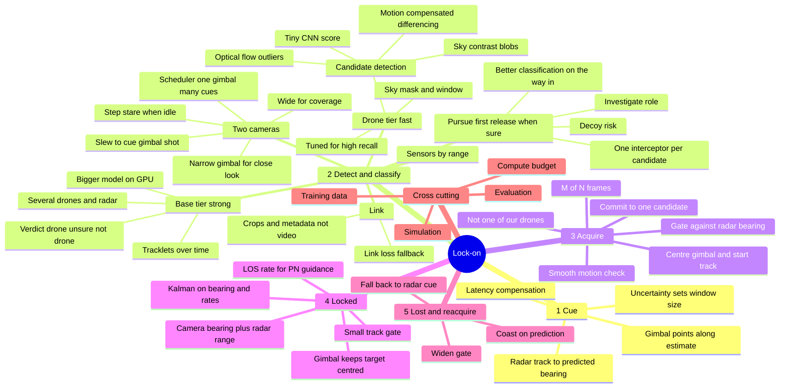

# Lock-on brainstorm

Brainstorm for the lock-on ability: how a friendly drone finds the hostile drone, decides it really is a drone, and keeps it locked. It follows the seeker idea from [[1octstella]]: the radar points the camera, so we only search a small window, and "locked" means a stable track.

**Working assumption (v1):** the hostile drone is mostly seen **against the sky**.

**Design rule: missing a drone is the worst outcome.** Every tier is tuned for recall. Flying toward a bird and having the base call it off later costs little; letting a drone through costs a lot.

Tags: `#idea` not discussed yet · `#leaning` favourite so far · `#rejected` dropped (kept with the reason)



---

## 1. Cue: where to look

The radar track gives a predicted direction to the hostile drone. The gimbal points the camera there before we search.

- Convert the radar track (position + covariance, NED) into a bearing (azimuth, elevation) from our drone. Its uncertainty sets how big the search window must be. #idea
- Numbers from [[1octstella]]: cross-range σ ≈ 23–25 m at the meeting point. Seen from 400 m, that is about ±10° at 3σ, which fits inside a ~20° camera view.
- Radar fixes arrive at 2 Hz and are ~100–500 ms old. Predict them forward to the camera frame's timestamp. #idea

## 2. Detect and classify: drone tier + base tier

**Idea:** two models in a cascade. The drone runs a fast, cheap model on every frame and sends what it finds to the base station. The base runs a stronger, slower model and gives the verdict. #leaning

**Pursue first, release when sure.** Because missing a drone is the worst outcome, any plausible candidate is pursued at once. The base's job is to **release** candidates it is sure are *not* drones, not to approve drones. The two decisions need different evidence:

| Decision | Evidence needed |
|---|---|
| Pursue / keep pursuing | Little: the drone tier's score, or the base saying "unsure" |
| Release (stop the chase) | A lot: the base is confident it's a bird or clutter |

**Three verdicts instead of two:** #leaning
- `DRONE`: commit → ACQUIRE → LOCKED.
- `UNSURE`: keep closing in. The target gets more pixels, so the next verdict will be better.
- `NOT_DRONE`: release. Allowed only above a high confidence threshold.

**Classification gets better on the way in.** A bird that is ~7 px at 400 m is ~28 px at 100 m, where telling it from a drone is much easier. So most false alarms are resolved during the approach, and the cost of a false alarm is "how far did we fly before we were sure". #idea

```text
DRONE (every frame, few ms)                         BASE STATION (GPU, ~100–300 ms)
camera frame
 → sky mask + window around the cue
 → candidate detector (A / B below)
 → tiny CNN score per candidate
 → crop + metadata ───────── radio link ──────────▶ group crops into tracklets
   (64×64 crop, bearing, time,                        (over time and across drones)
    drone pose, gimbal angles, score)               → strong classifier + radar features
                                                    → verdict: DRONE / BIRD / CLUTTER + confidence
                          ◀──────── assignment ───── → "drone N: ACQUIRE candidate K"
```

### Drone tier: fast, tuned not to miss

- **Goal:** catch ≥ 95–99 % of real drones (high recall). Many false alarms are fine, because the base filters them out. "Better than random" is not the target; *rarely missing a drone* is. #leaning
- It also throws away the obvious junk (noise, clouds, glare), so far less data goes over the link.

**Candidate detection.** Against the sky, the drone is a small dark blob on a bright, smooth background.

| Option | Idea | Status |
|---|---|---|
| A. Sky contrast blobs | Black-hat / top-hat morphology or a local adaptive threshold, then connected components. Keep blobs of plausible size | #leaning first version: cheap, no training |
| B. Motion-compensated differencing | Align the previous frame to the current one with a rotation-only homography (from attitude + gimbal; the background is effectively at infinity), subtract, keep what moved | #idea good second cue, and rejects static things like clouds |
| C. Optical flow outliers | The background moves together; the target moves differently | #idea noisy on a target only a few px wide |
| D. Tiny CNN score | A small net (MobileNet-sized or smaller) scores each candidate crop. A crop is so small that this takes about 1 ms | #idea the drone tier's "learned" part |

**Sky mask.** The horizon's position in the image follows from our drone's attitude plus the gimbal angles. Pixels above it are sky. Only search there in v1. #idea

**Target size in the image.** For a 20° camera at 1920 px, the focal length is ≈ 5440 px. A 0.5 m drone is then ~7 px at 400 m, ~5 px at 500 m and ~14 px at 200 m.

### The link: crops, not video

- Full video from every drone (several Mbit/s each) is too much for a swarm radio link. #rejected
- Send a crop per candidate (64×64, ~1–3 kB compressed) plus metadata. With 1–5 candidates at 10 Hz, that is ~10–150 kB/s per drone. #leaning
- This could be one more field in the planned `Detection` message ([[ai_components]]): the crop as `sensor_msgs/CompressedImage`. #idea
- **Don't wait for the base.** The drone acts on its own score at once (keeps the gimbal on the candidate, flies on toward it); the base's verdict confirms it or cancels it shortly after. #idea
- **Link lost:** the drone decides alone with stricter rules (more frames before it commits, a higher score threshold). #idea

### Base tier: strong, uses context the drone doesn't have

At 400 m the drone is ~7 px wide, so a bigger CNN alone can't see much more than the drone's model. The base's real advantage is context:

- **Time:** classify a *tracklet*, a short sequence of crops of one object (e.g. 0.5–1 s), not a single crop. Motion, flight path and wing flapping separate drones from birds. A temporal CNN or a small transformer on the sequence. #leaning
- **Several viewpoints:** if two drones see the same object, the base can triangulate its 3D position and get two independent looks. #idea
- **The radar:** speed, flight path and *micro-Doppler* (spinning rotors give drones a radar signature that birds don't have). Our mock radar doesn't simulate micro-Doppler yet. #idea
- **More compute:** a bigger model, or several models voting, on the base station's GPU. #idea
- **Delay:** the strong model needs a tracklet first, so the real delay is collecting ~0.5–1 s of frames, not the inference itself.

### Two cameras: wide for coverage, narrow gimbal for a close look

Each drone carries a **wide camera** (large FOV) to cover as much space as possible, and a **narrow camera on a gimbal** that turns toward anything worth a closer look. This is *slew-to-cue*. #leaning

```text
cues                                 narrow gimbal camera                 base
radar track (long range) ──┐
wide camera blob (nearby) ─┼──▶ scheduler ──▶ turn gimbal ──▶ "gimbal shot" ──▶ classify
other drones / base ───────┘     (one gimbal,      (~0.3–1 s     (high-res crop)
                                  many cues)       incl. settling)
```

**How far each camera sees.** Pixels on target ≈ f × size / range. For a 0.5 m drone (3–5 px is roughly the smallest detectable blob against the sky):

| Camera | f | 50 m | 100 m | 200 m | 400 m |
|---|---|---|---|---|---|
| Wide 115°, 1280 px (current gimbal cam) | ≈ 410 px | 4 px | 2 px | 1 px | — |
| Wide 115°, 4K (3840 px) | ≈ 1220 px | 12 px | 6 px | 3 px | 1.5 px |
| Narrow 20°, 1920 px | ≈ 5440 px | — | 27 px | 14 px | 7 px |

So the wide camera detects out to ~70 m (1280 px) or ~200 m (4K). It is the short-range search sensor and fills the radar's gaps, for example a drone flying low over the forest. Higher resolution buys range but costs compute and bandwidth. #idea

**Wide camera options:**
- One fixed camera facing forward. #idea
- Several fixed cameras for 360° (about 4 × 115° with overlap). #idea
- A fisheye. It covers the most, but the edges of the image are distorted and the pixels per degree are fewer. #idea

**Gimbal shot.** The narrow camera points at the candidate's bearing, waits for the image to settle, and takes a high-res crop, which goes to the base classifier. One sharp crop at 14–27 px can be worth more than a long tracklet of 2 px crops, so the base may decide faster. #leaning

**One gimbal, many cues: a scheduler.** The gimbal can only look at one thing at a time. Ideas for choosing: #idea
- Priority = drone score × closeness to the base × time since we last looked at it.
- Radar cues at long range get time slots; wide-camera cues nearby can interrupt (they are closer, so more urgent).
- When idle, the narrow camera scans the sky step by step (step-stare). That is slow: a 360° × 30° band in 20° steps is ~27 positions, about 6–9 s per sweep.
- Several drones can share the work: the base asks the drone with the best angle or the shortest range for the gimbal shot.

**Alternatives:** a zoom camera on the gimbal (one camera, wide when searching, narrow when looking). An event camera for the wide view: it only reports pixels that change, so small moving targets stand out and the data is tiny. #idea

### Sensors by range

From [[1octstella]] section 4–5 (first detection of a 0.5 m drone). The models used change with distance:

| Range | Sensor | Drone tier | Base tier |
|---|---|---|---|
| > 500 m (to 2 km+) | Base radar only | — | Radar-feature classifier (speed, track, micro-Doppler) |
| ~70–500 m | Narrow gimbal RGB (~20°), cued by the radar or the wide camera | Blobs + tiny CNN, ~5–15 px targets | Gimbal shot + tracklet classifier + radar + other drones |
| ~20–200 m | Wide RGB (115°: ~70 m at 1280 px, ~200 m at 4K), 3D lidar (30–50 m) | Blob detector on the whole wide image; cues the gimbal | Gimbal shot from the narrow camera; multi-sensor fusion |
| < 20 m | Depth camera | Depth blob (the sky is empty at 50 m altitude) | Not needed: too close to wait for the base |

### Training

- **Teacher → student:** the base model (teacher) labels data that trains the drone's tiny model (student), known as knowledge distillation. #idea
- Labels in simulation come for free: project the hostile drone's true position into the camera image. #idea

### What false alarms cost, and how to limit it

Pursuing every plausible candidate has a price:
- The interceptor leaves its place on the ring, which opens a gap in coverage while it is away. #idea
- Battery and time spent on the detour.
- **Decoys:** many birds or cheap decoys could pull interceptors away before the real attack comes. #idea

Ways to limit it:
- Send **one** interceptor per candidate. The rest re-form to cover the gap (the N−1 formation from [[ai_components]] 1c). #idea
- Have a separate `INVESTIGATE` role, alongside `INTERCEPT`: fly toward the candidate and look closer, but don't commit to a full intercept yet. #idea
- When candidates outnumber interceptors, pursue them in order of the base's drone score and of how close they are to the base. #idea

### Measuring it

- **Main metric: missed drones per track.** The target is close to 0; a first goal could be < 1 %.
- Drone tier: recall (should be ~99 %), and how much of the junk it removes.
- Base tier: per **track**, not per frame. Plain "accuracy" misleads, because most candidates are junk. Measure recall first, then the false-release rate (drones wrongly marked `NOT_DRONE`), which must be close to 0.
- Cost of false alarms: false pursuits per hour, and the distance or time flown before each one was released.
- Time from first detection to verdict.

## 3. Acquire: commit to the target

The base's verdict (or the drone's own decision, if the link is down) says *this candidate is a drone*. The interceptor commits to it and builds a track before declaring LOCKED.

- **Gate against the radar.** The candidate's direction must be within ~3σ of the radar-predicted direction (Mahalanobis distance). #idea
- **M of N frames.** For example, seen in 3 of the last 5 frames (the earlier sketch was 3 detections in 1 s). #idea
- **Smooth motion.** Its direction should change smoothly from frame to frame. Noise and flicker jump around. #idea
- **Not one of ours.** Reject candidates where one of our own drones is, using their known positions. #idea
- **Centre and start tracking.** Turn the gimbal to put the target in the centre, and start the bearing tracker. #idea
- **If nothing is found** in the window: grow the window step by step, or scan in a spiral around the cue. #idea

## 4. Locked: keep it

- **Track gate.** Only look in a small window around where the target is predicted to be in the next frame. Cheap enough to run every frame. #idea
- **Tracker.** Kalman filter on the camera bearing (azimuth, elevation and their rates). Fused with the radar range, that gives metre-level 3D position ([[1octstella]], section 5, point 3). #idea
- **Between detections:** detect every frame inside the gate, or use a visual tracker (template / KCF / CSRT) if detection is too slow. #idea
- **Gimbal control.** Keep the target in the centre: feed-forward from the track, plus a correction from the pixel error. #idea
- **Guidance output.** The line-of-sight rate goes to proportional navigation (PN), which needs no range. #idea
- **Closing in.** The target grows from ~7 px to hundreds of px. The detector must handle every size in between, or hand over to the depth camera / lidar in the last ~20 m (TERMINAL). #idea

## 5. Lost and reacquire

- Keep predicting the target's position for a few frames without a detection ("coasting"). #idea
- Widen the gate while coasting. #idea
- After ~1 s with no detection, drop the lock and go back to the radar cue → ACQUIRE. #idea
- Typical causes: the target leaves the view, passes in front of trees or ground (the sky assumption breaks), sun glare, or the gimbal moves too slowly.

## Cross-cutting

**Simulation**
- We need a two-camera drone model: a fixed wide camera plus a narrow (~20°) camera on the gimbal. The current `gz_x500_gimbal` has a single 115° camera. Build it as a custom model in `worlds/models/`, like `x500_lidar_3d`. Two cameras per drone cost GPU rendering time, so start with one or two such drones. #idea
- Gazebo's sky is plain and evenly lit, which makes v1 too easy. Add clouds, sun glare, noise and blur to make it harder. #idea
- Bird-like distractors in the world. #idea
- Simulate the radio link (bandwidth, delay, dropped packets) between the drones and the base. #idea

**Evaluation**
- Time from cue to lock, detection range, how often the lock is lost, false locks per minute, pointing error (degrees).

**Compute**
- Drone: per-frame budget on a Jetson-class computer. Detectors run only on a cropped window are cheap. #idea
- Base: a GPU (on Stellar: RTX 3090 Ti). #idea

---

## Decided

- v1 assumes the hostile drone is against the sky.
- The narrow camera is always pointed by a cue (radar, wide camera, other drones). The wide camera is searched whole, but only with a cheap blob detector.
- Two tiers: a fast model on the drone and a strong one at the base. **Both are tuned for recall:** missing a drone is the worst outcome.
- Pursue first, release when sure. Any plausible candidate is pursued at once; the base only stops a chase when it is confident the candidate is not a drone.
- Two cameras per drone: a wide one for coverage and a narrow one on a gimbal for gimbal shots (slew-to-cue).

## Open questions

- [ ] Camera: what resolution, FOV and frame rate for the narrow gimbal camera?
- [ ] Does Gazebo give realistic sky contrast, or do we have to add noise ourselves?
- [ ] When does the sky assumption break in our scenario (hostile drone flying low over the forest)?
- [ ] How long a tracklet does the base need for a > 90 % verdict, and is that delay acceptable at a 21–29 m/s closing speed?
- [x] What does the drone do while it waits for the base? → Keeps closing in (pursue first).
- [x] What should "> 90 %" mean? → Recall first. Missing a drone is the worst outcome; the target is < 1 % missed drones per track.
- [ ] How confident must the base be before it releases a candidate (`NOT_DRONE`)? Choose the threshold so drones are almost never released, then measure what that costs in false pursuits.
- [ ] How many simultaneous false alarms can the swarm absorb before the ring has dangerous gaps?
- [ ] Wide camera: one forward camera, several for 360°, or a fisheye? And which resolution (range vs compute)?
- [ ] How fast does the gimbal turn and settle? That limits how many gimbal shots per second one drone can take.
- [ ] What does the narrow camera do when nothing is cued: scan the sky step by step, or wait?

Related: [[Home]], [[1octstella]], [[ai_components]], [[Codebase map]]
