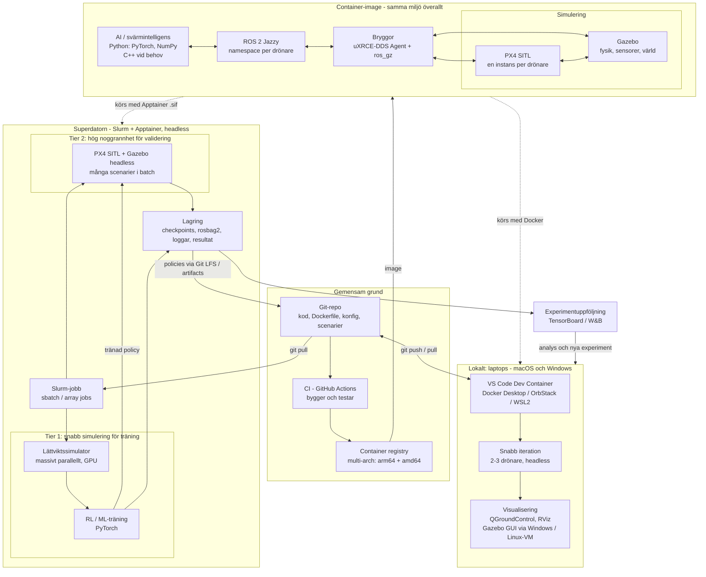

# Teknikstack för AI-projekt med drönarsvärm

**Stack:** Docker · ROS 2 · PX4 · Gazebo · Python/C++ · Superdator (HPC)
**Team:** 6 personer på macOS (Apple Silicon) och Windows, med tillgång till en superdator.

---

## 1. Sammanfattning

Projektets fokus är **svärmintelligens och autonomt samarbete**, inte att bygga ett flyg- och simuleringssystem från grunden. Därför delas systemet upp i lager där varje komponent har ett tydligt ansvar:

- **PX4** sköter flygkontrollen (stabilisering, positionsreglering, motorstyrning).
- **Gazebo** simulerar världen, fysiken och sensorerna.
- **ROS 2** kopplar ihop AI-lagret, PX4 och simuleringen.
- **Python (och C++ vid behov)** används för AI och svärmlogik.
- **Docker** ger alla i teamet samma miljö, och samma image körs som Apptainer-container på superdatorn.

Två designbeslut styr resten av dokumentet:

1. **Två simuleringsnivåer.** En snabb, lättviktig simulator för träning och algoritmutveckling, och PX4 + Gazebo för realistisk validering.
2. **Två körmiljöer.** Laptops används för utveckling och snabba tester (små simuleringar, headless). Superdatorn används för tunga experiment: träning, batchvalidering och parameterstudier.

---

## 2. Övergripande arkitektur



**Så ska grafen läsas:**

- **Docker är miljön runt allt**, inte ett lager mellan ROS 2 och PX4/Gazebo. Alla komponenter i `IMG` körs inuti samma container.
- **Kod flödar via Git**, **miljön flödar via container registry**, och **resultat flödar tillbaka från superdatorn** till laptoparna för analys.
- **Tränade policies** förs tillbaka in i AI-lagret via Git LFS eller artifacts och kan då köras i samma ROS 2-noder både lokalt och på superdatorn.

---

## 3. Komponenter och ansvar

| Komponent | Ansvar | Anmärkning |
|---|---|---|
| **Docker / Apptainer** | Reproducerbar miljö med fasta versioner | Docker på laptops, Apptainer på HPC (Docker tillåts sällan där) |
| **ROS 2 (Jazzy)** | Kommunikation via topics, services och actions | Namespace per drönare från dag ett |
| **PX4 (SITL)** | Lågnivåflygkontroll | En instans per drönare i simulering |
| **uXRCE-DDS Agent** | Brygga mellan PX4 och ROS 2 | Kopplar PX4:s uORB-meddelanden till ROS 2-topics (`/fmu/in/...`, `/fmu/out/...`) |
| **ros_gz** | Brygga mellan Gazebo och ROS 2 | För sensordata (kamera, lidar, m.m.) |
| **Gazebo (gz)** | Fysik, sensorer, kollisioner, världar | Headless på Mac och HPC |
| **Python** | AI, ML, högnivålogik | PyTorch, NumPy, OpenCV, scikit-learn |
| **C++** | Prestandakritiska noder | Först när profilering visar ett verkligt problem |
| **Slurm** | Jobbkö på superdatorn | Array jobs för många scenarier |
| **rosbag2** | Loggning och uppspelning | Grunden för utvärdering och debugging |
| **Git + CI** | Versionshantering, automatiska byggen och tester | Container-bygge och `colcon test` i CI |

### Ubuntu/Linux

Ubuntu 24.04 är målmiljön eftersom ROS 2 Jazzy, PX4 och Gazebo har starkast stöd där. Den finns **inuti containern**, så ingen behöver installera Linux direkt på sin dator:

- **Windows:** Docker Desktop med WSL2.
- **macOS (Apple Silicon):** Docker Desktop eller OrbStack med ARM64-images. Behövs Gazebo-GUI lokalt krävs en Ubuntu 24.04 ARM64-VM (t.ex. UTM eller Parallels).

### PX4 och ROS 2 tillsammans

PX4 pratar med ROS 2 via **uXRCE-DDS-agenten** (standardport UDP 8888). Utan den når inte ROS 2-noderna flygkontrollern. Kommandon på hög nivå (waypoints, hastighetsmål, offboard-läge) skickas från AI-lagret, och PX4 översätter dem till motorstyrning.

---

## 4. Simulering i två nivåer

Att träna svärmalgoritmer, särskilt med reinforcement learning, direkt i PX4 + Gazebo är för långsamt. Varje drönare kräver en egen PX4-instans plus fysik och sensorer, och simuleringen är inte gjord för tusentals snabba episoder. Därför används två nivåer:

| | **Tier 1: snabb sim** | **Tier 2: PX4 + Gazebo** |
|---|---|---|
| **Syfte** | Utveckla och träna svärmalgoritmer | Validera med realistisk flygdynamik |
| **Detaljnivå** | Förenklad dynamik | PX4-flygkontroll, Gazebo-fysik, sensormodeller |
| **Hastighet** | Snabbare än realtid, massivt parallellt | Nära eller långsammare än realtid |
| **Var** | Främst superdatorn (GPU) | Laptops (små tester) och superdatorn (batch) |
| **Exempel** | Egen Python-miljö, gym-pybullet-drones eller liknande | `px4_sitl` + `gz` + ROS 2-bryggor |

**Nyckelprincip:** Skriv AI-koden så att samma policy kan köras mot båda nivåerna. Bara en tunn adapter (observationer in, kommandon ut) ska skilja sig mellan simulatorn och ROS 2/PX4.

---

## 5. Utvecklingsmiljö

### 5.1 Föreslagen repo-struktur

```text
projekt/
├── .devcontainer/
│   └── devcontainer.json      # VS Code Dev Container
├── docker/
│   └── Dockerfile             # bygger på PX4:s officiella image
├── compose.yaml
├── ros2_ws/
│   └── src/                   # egna ROS 2-paket (AI, launch, konfig)
├── scenarios/                 # scenariodefinitioner och Gazebo-världar
├── training/                  # träningskod för Tier 1
├── hpc/                       # Slurm-skript och Apptainer-definitioner
├── .gitattributes             # *.sh text eol=lf
├── .gitignore                 # build/ install/ log/
└── README.md
```

### 5.2 Dockerfile (utgångspunkt)

PX4 tillhandahåller `px4io/px4-sitl-gazebo-ros2`, som innehåller PX4, Gazebo, ROS 2, uXRCE-DDS-agenten och `px4_msgs` som matchar firmwaren. Bilden finns för både `amd64` och `arm64`, så Mac (M2) och Windows-datorer får varsin nativ bild utan emulering.

```dockerfile
# Pinna digest i stället för "latest" så att alla har exakt samma miljö
FROM px4io/px4-sitl-gazebo-ros2@sha256:<DIGEST>

RUN apt-get update && apt-get install -y \
    python3-pip python3-colcon-common-extensions \
    && rm -rf /var/lib/apt/lists/*

# Python-beroenden för AI-delen
COPY requirements.txt /tmp/requirements.txt
RUN pip3 install --break-system-packages -r /tmp/requirements.txt
```

> **Viktigt:** Ändrar ni PX4-firmware eller meddelandedefinitioner måste ROS-workspacen (`px4_msgs`) byggas om så att den matchar. Antag inte att de medföljande meddelandena är kompatibla.

Kontrollera vilken Gazebo-version (och ROS 2-distribution) den valda bilden faktiskt innehåller innan ni låser er, och skriv ner den i README.

### 5.3 Snabbstart: headless simulering

Kör i tre olika terminaler:

```bash
# Terminal 1: container + DDS-agent
docker run --rm -it --name px4-gazebo-ros2 \
  px4io/px4-sitl-gazebo-ros2:latest MicroXRCEAgent udp4 -p 8888

# Terminal 2: PX4 + headless Gazebo
docker exec -it px4-gazebo-ros2 \
  /usr/local/bin/ros2-entrypoint.sh env HEADLESS=1 px4-gazebo

# Terminal 3: lista ROS 2-topics
docker exec -it px4-gazebo-ros2 \
  /usr/local/bin/ros2-entrypoint.sh ros2 topic list
```

PX4, agenten och ROS 2 kommunicerar inuti samma container, så host-nätverk behövs inte. ROS-noder utanför containern kräver extra DDS-nätverkskonfiguration, så kör helst era egna noder i samma container.

### 5.4 macOS (Apple Silicon)

- Använd **ARM64-images** och tvinga aldrig `--platform linux/amd64` (emulering är långsam och Gazebo kraschar ofta).
- **Gazebo körs headless** (`HEADLESS=1`). PX4:s egen utvärdering visar att GUI via XQuartz inte renderar Gazebo korrekt på macOS.
- Följ simuleringen via **QGroundControl** (nativ macOS-app), RViz och ROS 2-topics.
- Behövs Gazebo-GUI lokalt: använd en **Ubuntu 24.04 ARM64-VM** (UTM, Parallels eller VMware Fusion) med Docker inuti.
- Ge Docker minst 4 CPU och 8 GB RAM.
- Containrar på macOS kan i regel inte använda GPU:n, så all träning bör ske på superdatorn.

#### 5.4.1 Steg-för-steg: allt igång på macOS (Apple Silicon)

1. **Installera Docker Desktop** (Apple Silicon-version) eller **OrbStack**. I Docker Desktop → Settings → Resources: ge minst 4 CPU och 8 GB RAM.
2. **Installera VS Code** och tillägget **Dev Containers** (`ms-vscode-remote.remote-containers`).
3. **Klona repot:**
   ```bash
   git clone <repo-url>
   cd projekt
   ```
4. **Öppna i Dev Container:** öppna mappen i VS Code → kommandopalett (`Cmd+Shift+P`) → **"Dev Containers: Reopen in Container"**. Detta bygger/hämtar containern enligt `.devcontainer/devcontainer.json` och `docker/Dockerfile` (ARM64-imagen hämtas automatiskt på Apple Silicon).
5. **Verifiera att du är inne i containern:** terminalen i VS Code ska nu vara en shell inuti containern (prompten ändras). Kontrollera Ubuntu-versionen:
   ```bash
   cat /etc/os-release
   ```
6. **Bygg ROS 2-workspacen** (inklusive din Python-backend som paket under `ros2_ws/src/`, se avsnitt 5.7):
   ```bash
   cd ros2_ws
   colcon build --symlink-install
   source install/setup.bash
   ```
7. **Starta PX4 + headless Gazebo + DDS-agent** i containerterminalen:
   ```bash
   HEADLESS=1 /usr/local/bin/ros2-entrypoint.sh px4-gazebo
   ```
8. **Öppna en andra terminal i samma container** (VS Code: `+` i terminalpanelen öppnar en ny shell i samma Dev Container) och kontrollera att topics finns:
   ```bash
   source install/setup.bash
   ros2 topic list
   ```
   Du bör se `/fmu/out/...` och `/fmu/in/...`-topics från PX4.
9. **Starta din Python-backend** som ROS 2-nod, i en tredje terminal i samma container:
   ```bash
   source install/setup.bash
   ros2 run swarm_backend backend_node
   ```
10. **Visualisera från macOS:** installera **QGroundControl** (native macOS-app, laddas ner separat, inte i containern) och anslut den mot simuleringen för att se drönaren flyga. RViz kan köras inuti containern om X11-forwarding sätts upp, men det rekommenderas inte på macOS (se ovan) — luta dig mot QGroundControl och `ros2 topic echo` för felsökning istället.

Om du behöver Gazebo-GUI (inte bara headless) lokalt: sätt upp en Ubuntu 24.04 ARM64-VM (UTM/Parallels/VMware Fusion) med Docker inuti och upprepa steg 3–9 där.

### 5.5 Windows

- Docker Desktop med **WSL2**.
- **Lägg repot i WSL:s filsystem** (`~/projekt`), inte under `/mnt/c/...`, annars blir filåtkomsten mycket långsam.
- Sätt `eol=lf` för skript i `.gitattributes`, annars kraschar shell-skript med Windows-radslut (CRLF) i containern.
- Gazebo-GUI via WSLg kan fungera, men GPU-acceleration har extra krav på drivrutiner och Docker-backend. Mjukvarurendering fungerar utan GPU-passthrough men är långsam.

### 5.6 Gemensamma arbetsrutiner

- **Dev Containers:** alla öppnar repot i samma VS Code Dev Container.
- **Färdig image:** bygg multi-arch-bilden i CI (`docker buildx`, `linux/amd64,linux/arm64`) och publicera till GitHub Container Registry. Ingen ska behöva bygga bilden lokalt.
- **Volymer:** mounta källkoden (`ros2_ws/src`) som bind mount, men lägg `build/`, `install/` och `log/` i namngivna Docker-volymer (snabbare på Mac och Windows).
- **ROS_DOMAIN_ID:** använd olika värden per person om ni sitter på samma nätverk, så att simuleringar inte stör varandra.
- **Git:** feature-branches och pull requests. CI kör `colcon build` och `colcon test` i containern.
- **Versionsfastlåsning:** pinna image-digest, Python-beroenden (`requirements.txt` med versioner) och PX4-version.

### 5.7 Python-backend: kör i samma container (rekommenderat lokalt)

Kör Python-backenden som en vanlig **ROS 2-nod** (`rclpy`) inuti samma container som PX4, Gazebo och resten av ROS 2 — inte som en separat process på host-datorn.

- **Varför:** ingen container-till-host-nätverkskonfiguration för DDS-diskovery krävs. Allt delar samma `ROS_DOMAIN_ID` och ser varandra direkt.
- **Alternativet (backend på host, `localhost`) fungerar dåligt på Mac/Windows:** Docker Desktop kör containern i en VM, så `--network host` delar inte host-nätverket tillförlitligt där. På **Linux (t.ex. superdatorn)** fungerar `--network host` bra, men det är inte värt att ha olika uppsättningar lokalt kontra HPC bara för det.
- **Live-utveckling fungerar ändå:** `ros2_ws/src` är bind-mountad (avsnitt 5.6), så ändringar i Python-koden på laptopen syns direkt inuti containern. Starta om noden/launch-filen för att ladda in ändringen — ingen rebuild av imagen krävs. VS Code Dev Containers kan även attacha debuggern och sätta breakpoints i kod som körs inuti containern.
- **Placering i repot:** lägg backenden som ett eget paket under `ros2_ws/src/` (t.ex. `swarm_backend/`), byggt med `colcon` tillsammans med övriga ROS 2-paket.

---

## 6. Superdatorn (HPC)

Superdatorn kör **Linux** som värdoperativsystem (inte macOS eller Windows). Det innebär att ingen virtualiseringslager som Docker Desktop eller WSL2 behövs där, till skillnad från laptoparna i avsnitt 5 — containern (via Apptainer) körs direkt på värdens Linux-kärna, vilket normalt ger bättre prestanda och enklare GPU-passthrough.

### 6.1 Frågor att ställa till administratörerna först

1. Finns **Apptainer** (eller Singularity)? Kan ni hämta images från internet, eller måste de laddas upp manuellt?
2. Vilka **GPU:er** finns, och hur köar man för dem i Slurm?
3. Fungerar **headless rendering** (EGL eller mjukvarurendering) på beräkningsnoderna? Kamerasensorer i Gazebo kräver rendering även utan GUI.
4. Vilka **kvoter** gäller för lagring, jobbtid och antal samtidiga jobb?
5. Har beräkningsnoderna **utgående nätverk**? Annars måste alla beroenden ingå i imagen.

### 6.2 Arbetsflöde

1. Bygg Docker-bilden i CI och publicera till registry.
2. Konvertera på superdatorn: `apptainer pull swarm.sif docker://ghcr.io/<org>/<image>:<tag>`
3. Skicka jobb med Slurm.
4. Spara checkpoints, rosbags och loggar på projektlagringen.
5. Ladda ner resultat och analysera lokalt (TensorBoard/W&B, rosbag2).

### 6.3 Exempel på Slurm-skript (batchvalidering)

Skriptet är en mall. Partitioner, GPU-flaggor och launch-filer måste anpassas.

```bash
#!/bin/bash
#SBATCH --job-name=swarm-val
#SBATCH --array=0-49            # 50 scenarier
#SBATCH --cpus-per-task=8
#SBATCH --mem=16G
#SBATCH --time=01:00:00
#SBATCH --output=logs/%x_%A_%a.out

# Lägg till --nv i apptainer-kommandot och --gres=gpu:1 ovan om GPU behövs
apptainer exec --cleanenv swarm.sif bash -lc "
  ros2 launch swarm_bringup validation.launch.py \
    scenario:=${SLURM_ARRAY_TASK_ID} headless:=true
"
```

---

## 7. Svärmdesign

### 7.1 Centraliserad eller decentraliserad styrning

Detta måste väljas tidigt eftersom det påverkar hela arkitekturen:

| | **Centraliserad** | **Decentraliserad** |
|---|---|---|
| Idé | En central AI-nod styr alla drönare | Varje drönare beslutar själv med lokal information |
| Fördelar | Enklare att implementera och felsöka | Robustare, skalar bättre, mer realistisk för svärmar |
| Nackdelar | Enskild felpunkt, skalar sämre | Svårare att designa, felsöka och utvärdera |
| ROS 2-mönster | En nod, många drönar-namespaces | En AI-nod per drönare, kommunikation dem emellan |

Ett rimligt upplägg är att börja centraliserat som baslinje och sedan bygga en decentraliserad variant att jämföra med.

### 7.2 Kommunikationsbegränsningar

Simulera **begränsad räckvidd, fördröjning och paketförlust** mellan drönare. Annars förlitar sig svärmen på perfekt ROS 2-kommunikation, vilket inte stämmer med verkligheten. Ett enkelt sätt är en "kommunikationsfilter"-nod som vidarebefordrar meddelanden mellan drönare endast om de är inom räckvidd.

### 7.3 Möjliga AI-metoder att undersöka

- Uppgiftsfördelning (t.ex. auktionsbaserad eller optimeringsbaserad)
- Formationsflygning och konsensusalgoritmer
- Kollisionsundvikande (t.ex. potentialfält, ORCA, lärda policies)
- Samordnad utforskning och täckning
- Banplanering
- Multi-agent reinforcement learning

---

## 8. Utvärdering

Definiera scenarier, baslinjer och mätetal tidigt, annars går det inte att visa att AI-lösningen gör nytta.

- **Scenarier:** t.ex. sök-och-täck ett område, formationsflygning genom hinder, drönare som tappar kommunikation eller havererar.
- **Baslinjer:** enkel regelbaserad svärm (t.ex. förutbestämda banor eller grannbaserade regler).
- **Mätetal:** antal kollisioner, täckningsgrad över tid, tid till slutförd uppgift, energiförbrukning, kommunikationsbelastning, robusthet vid bortfall av drönare.
- **Statistik:** kör varje scenario med många slumpfrön och rapportera medelvärde och spridning. Det är här superdatorn ger mest nytta.
- **Loggning:** spara allt med rosbag2 så att experiment kan spelas upp och analyseras i efterhand.

---

## 9. Risker och åtgärder

| Risk | Åtgärd |
|---|---|
| PX4 + Gazebo blir för tungt för många drönare | Bestäm max antal drönare i vecka 1 och testa det. Kör stora scenarier på superdatorn. |
| RL fungerar dåligt i PX4 + Gazebo | Använd Tier 1-simulator för träning, validera i Tier 2. |
| Ingen GPU i Docker på Mac | Träna på superdatorn eller en Windows/Linux-dator med NVIDIA-GPU. |
| Gazebo-GUI fungerar inte på Mac | Headless + QGroundControl/RViz, eller Ubuntu ARM-VM. |
| Miljöskillnader mellan teammedlemmar | Dev Container, pinnad image-digest, CI. |
| Docker inte tillåtet på superdatorn | Apptainer/Singularity med `.sif` konverterad från Docker-bilden. |
| Headless rendering fungerar inte på HPC-noder | Kontrollera med admins. Undvik kamerasensorer i batchtester eller använd mjukvarurendering. |
| `px4_msgs` matchar inte PX4-versionen | Pinna versioner, bygg om workspace vid ändringar. |
| DDS-belastning växer med antal noder | Namespaces, `ROS_DOMAIN_ID`, mät nätverkstrafik tidigt. |
| Oklart vad "bra" betyder | Definiera scenarier, baslinjer och mätetal (avsnitt 8). |

---

## 10. Beslut att ta tidigt

- [ ] Hur många drönare ska svärmen bestå av som mest?
- [ ] Ska RL/ML-träning ingå? Isåfall vilken Tier 1-simulator?
- [ ] Centraliserad eller decentraliserad styrning (eller båda)?
- [ ] Behövs kamera/lidar-sensorer (påverkar simuleringskostnad och HPC-rendering)?
- [ ] Vem i teamet har Gazebo-GUI (Windows/Linux) för visualisering, och vem sätter upp en Linux-VM på Mac?
- [ ] Vilken ROS 2-distribution och Gazebo-version låser vi oss vid?
- [ ] Hur överför vi images och data till och från superdatorn?
- [ ] Ska vi utvärdera befintliga ramverk (t.ex. Aerostack2) innan vi bygger eget?

---

## 11. Föreslagen fasplan

**Fas 1: Miljö (vecka 1–2)**
- Repo, Dockerfile, Dev Container och CI med multi-arch-bygge.
- Alla i teamet kör headless-simulering med en drönare lokalt.
- Kontakt med HPC-admins, körning av en testcontainer på superdatorn.

**Fas 2: Grund (vecka 3–4)**
- Fler drönare i simuleringen, namespaces, offboard-styrning via ROS 2.
- Första enkla svärmbeteendet (t.ex. formation eller täckning) som baslinje.
- Loggning med rosbag2 och första mätetal.

**Fas 3: AI-lagret (vecka 5–8)**
- Tier 1-simulator och träningspipeline på superdatorn.
- Utveckling av valda svärmmetoder.
- Kommunikationsbegränsningar i simuleringen.

**Fas 4: Validering och utvärdering (vecka 9–10)**
- Batchvalidering i PX4 + Gazebo på superdatorn.
- Jämförelse mot baslinjer med flera slumpfrön.
- Analys, dokumentation och rapport.

*Tidsplanen är ett förslag och behöver anpassas efter projektets omfattning.*
