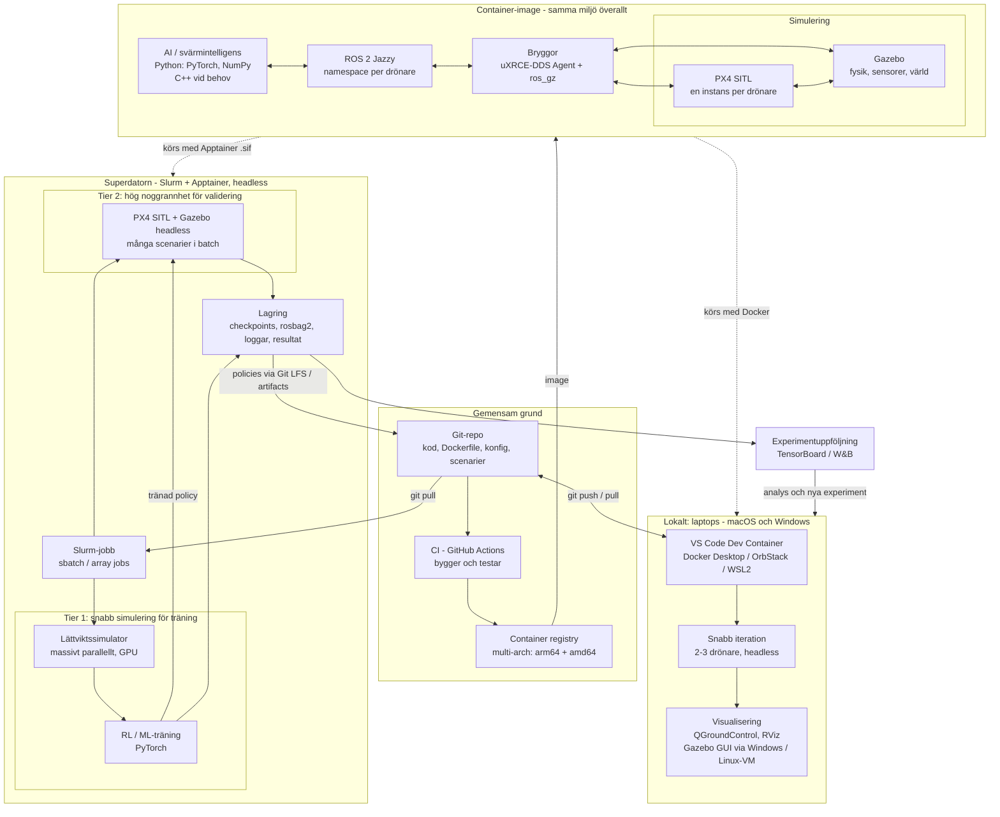

# Teknikstack för AI-projekt med drönarsvärm

**Stack:** Docker · ROS 2 · PX4 · Gazebo · Python/C++ · Superdator (HPC)
**Team:** 6 personer på macOS (Apple Silicon) och Windows, med tillgång till en superdator.

---

## 1. Sammanfattning

Projektets fokus är **svärmintelligens och autonomt samarbete**, inte att bygga ett flyg- och simuleringssystem från grunden. Därför delas systemet upp i lager där varje komponent har ett tydligt ansvar:

- **PX4** sköter flygkontrollen (stabilisering, positionsreglering, motorstyrning).
- **Gazebo** simulerar världen, fysiken och sensorerna.
- **ROS 2** kopplar ihop AI-lagret, PX4 och simuleringen.
- **Python (och C++ vid behov)** används för AI och svärmlogik.
- **Docker** ger alla i teamet samma miljö, och samma image körs som Apptainer-container på superdatorn.

Två designbeslut styr resten av dokumentet:

1. **Två simuleringsnivåer.** En snabb, lättviktig simulator för träning och algoritmutveckling, och PX4 + Gazebo för realistisk validering.
2. **Två körmiljöer.** Laptops används för utveckling och snabba tester (små simuleringar, headless). Superdatorn används för tunga experiment: träning, batchvalidering och parameterstudier.

---

## 2. Övergripande arkitektur



**Så ska grafen läsas:**

- **Docker är miljön runt allt**, inte ett lager mellan ROS 2 och PX4/Gazebo. Alla komponenter i `IMG` körs inuti samma container.
- **Kod flödar via Git**, **miljön flödar via container registry**, och **resultat flödar tillbaka från superdatorn** till laptoparna för analys.
- **Tränade policies** förs tillbaka in i AI-lagret via Git LFS eller artifacts och kan då köras i samma ROS 2-noder både lokalt och på superdatorn.

---

## 3. Komponenter och ansvar

| Komponent              | Ansvar                                           | Anmärkning                                                                       |
| ---------------------- | ------------------------------------------------ | -------------------------------------------------------------------------------- |
| **Docker / Apptainer** | Reproducerbar miljö med fasta versioner          | Docker på laptops, Apptainer på HPC (Docker tillåts sällan där)                  |
| **ROS 2 (Jazzy)**      | Kommunikation via topics, services och actions   | Namespace per drönare från dag ett                                               |
| **PX4 (SITL)**         | Lågnivåflygkontroll                              | En instans per drönare i simulering                                              |
| **uXRCE-DDS Agent**    | Brygga mellan PX4 och ROS 2                      | Kopplar PX4:s uORB-meddelanden till ROS 2-topics (`/fmu/in/...`, `/fmu/out/...`) |
| **ros_gz**             | Brygga mellan Gazebo och ROS 2                   | För sensordata (kamera, lidar, m.m.)                                             |
| **Gazebo (gz)**        | Fysik, sensorer, kollisioner, världar            | Headless på Mac och HPC                                                          |
| **Python**             | AI, ML, högnivålogik                             | PyTorch, NumPy, OpenCV, scikit-learn                                             |
| **C++**                | Prestandakritiska noder                          | Först när profilering visar ett verkligt problem                                 |
| **Slurm**              | Jobbkö på superdatorn                            | Array jobs för många scenarier                                                   |
| **rosbag2**            | Loggning och uppspelning                         | Grunden för utvärdering och debugging                                            |
| **Git + CI**           | Versionshantering, automatiska byggen och tester | Container-bygge och `colcon test` i CI                                           |

### Ubuntu/Linux

Ubuntu 24.04 är målmiljön eftersom ROS 2 Jazzy, PX4 och Gazebo har starkast stöd där. Den finns **inuti containern**, så ingen behöver installera Linux direkt på sin dator:

- **Windows:** Docker Desktop med WSL2.
- **macOS (Apple Silicon):** Docker Desktop eller OrbStack med ARM64-images. Behövs Gazebo-GUI lokalt krävs en Ubuntu 24.04 ARM64-VM (t.ex. UTM eller Parallels).

### PX4 och ROS 2 tillsammans

PX4 pratar med ROS 2 via **uXRCE-DDS-agenten** (standardport UDP 8888). Utan den når inte ROS 2-noderna flygkontrollern. Kommandon på hög nivå (waypoints, hastighetsmål, offboard-läge) skickas från AI-lagret, och PX4 översätter dem till motorstyrning.

---

## 4. Simulering i två nivåer

Att träna svärmalgoritmer, särskilt med reinforcement learning, direkt i PX4 + Gazebo är för långsamt. Varje drönare kräver en egen PX4-instans plus fysik och sensorer, och simuleringen är inte gjord för tusentals snabba episoder. Därför används två nivåer:

|                | **Tier 1: snabb sim**                                 | **Tier 2: PX4 + Gazebo**                       |
| -------------- | ----------------------------------------------------- | ---------------------------------------------- |
| **Syfte**      | Utveckla och träna svärmalgoritmer                    | Validera med realistisk flygdynamik            |
| **Detaljnivå** | Förenklad dynamik                                     | PX4-flygkontroll, Gazebo-fysik, sensormodeller |
| **Hastighet**  | Snabbare än realtid, massivt parallellt               | Nära eller långsammare än realtid              |
| **Var**        | Främst superdatorn (GPU)                              | Laptops (små tester) och superdatorn (batch)   |
| **Exempel**    | Egen Python-miljö, gym-pybullet-drones eller liknande | `px4_sitl` + `gz` + ROS 2-bryggor              |

**Nyckelprincip:** Skriv AI-koden så att samma policy kan köras mot båda nivåerna. Bara en tunn adapter (observationer in, kommandon ut) ska skilja sig mellan simulatorn och ROS 2/PX4.

---

## 5. Utvecklingsmiljö

### 5.1 Föreslagen repo-struktur

```text
projekt/
├── .devcontainer/
│   └── devcontainer.json      # VS Code Dev Container
├── docker/
│   └── Dockerfile             # bygger på PX4:s officiella image
├── compose.yaml
├── ros2_ws/
│   └── src/                   # egna ROS 2-paket (AI, launch, konfig)
├── scenarios/                 # scenariodefinitioner och Gazebo-världar
├── training/                  # träningskod för Tier 1
├── hpc/                       # Slurm-skript och Apptainer-definitioner
├── .gitattributes             # *.sh text eol=lf
├── .gitignore                 # build/ install/ log/
└── README.md
```

### 5.2 macOS (Apple Silicon)

- Använd **ARM64-images** och tvinga aldrig `--platform linux/amd64` (emulering är långsam och Gazebo kraschar ofta).
- **Gazebo körs headless** (`HEADLESS=1`) som standard för vanlig kodning/iteration — snabbast, minst resurskrävande.
- Följ simuleringen via **QGroundControl** (nativ macOS-app) och ROS 2-topics när du inte behöver se 3D-världen.
- Behövs Gazebo-GUI: använd **VNC-lagret i avsnitt 5.2.3 (verifierat, rekommenderat)** — inte XQuartz (opålitlig rendering av Gazebo på macOS) och inte en Ubuntu-VM om det går att undvika (tyngre att sätta upp per person).
- Ge Docker minst 4 CPU och 8 GB RAM.
- **Containrar på macOS kan inte använda GPU:n** (hård plattformsbegränsning, inget som går att fixa i containern) — Gazebo renderar därför alltid med mjukvara (`llvmpipe`) på Mac, vilket äter CPU och gör GUI-läget märkbart segt. Se avsnitt 5.6 om ni vill köra på en dator med GPU istället.

#### 5.2.1 Steg-för-steg: verifierad snabbstart på macOS (manuellt, utan Dev Container ännu)

Detta är den faktiska sekvens som testats och verifierats fungera end-to-end (container → PX4 SITL → Gazebo → QGroundControl → flera drönare). Kör varje steg i en egen terminal och lämna dem igång.

1. **Installera Docker Desktop** (Apple Silicon) eller OrbStack. Settings → Resources: minst 4 CPU, 8 GB RAM.
2. **Terminal 1 — starta containern + DDS-agenten** (mountar repot så Python-filer är nåbara):
   ```bash
   docker run --rm -it --name px4-gazebo-ros2 \
     -v $(pwd):/workspace \
     px4io/px4-sitl-gazebo-ros2:latest MicroXRCEAgent udp4 -p 8888
   ```
3. **Terminal 2 — drönare 0** (headless, standardvärld och standarddrönare, inget eget behöver byggas för att testa):
   ```bash
   docker exec -it px4-gazebo-ros2 bash -c "
     export HEADLESS=1 PX4_SIM_MODEL=gz_x500 PX4_GZ_MODEL_POSE='0,0,0,0,0,0'
     /usr/local/bin/ros2-entrypoint.sh px4-gazebo -i 0
   "
   ```
4. **Terminal 3 — verifiera topics:**
   ```bash
   docker exec px4-gazebo-ros2 /usr/local/bin/ros2-entrypoint.sh ros2 topic list
   ```
   Förväntat: `/fmu/out/...` och `/fmu/in/...`.
5. **Installera QGroundControl**https://docs.qgroundcontrol.com/Stable_V5.1/en/qgc-user-guide/getting_started/download_and_install.html , macOS `.dmg`) och öppna den. Den ansluter **automatiskt** — imagens `px4-rc.mavlink` skickar redan GCS-telemetri till `192.168.65.254:14550`, Docker Desktop för Mac:s inbyggda host-gateway-IP. Ingen extra portpublicering eller konfiguration krävs. Om den inte ansluter: kontrollera macOS brandvägg (System Settings → Network → Firewall) tillåter inkommande anslutningar till QGroundControl.
6. **Testa att flyga:** i PX4-terminalen (Terminal 2, vid `pxh>`-prompten):
   ```
   commander takeoff
   ```
   Om det ger `Arming denied: Resolve system health failures first` — det är nästan alltid att QGroundControl inte är anslutet än (steg 5). Anslut QGC först, arma/lyft sedan antingen via `commander takeoff` igen eller QGC:s egna arm/takeoff-knappar.
7. **Starta din Python-backend** som ROS 2-nod (avsnitt 5.5), i en egen terminal:
   ```bash
   docker exec -it px4-gazebo-ros2 \
     /usr/local/bin/ros2-entrypoint.sh python3 /workspace/backend.py
   ```

#### 5.2.2 Flera drönare (verifierat)

PX4 SITL stödjer flera instanser i **samma** Gazebo-värld och **samma** ROS 2-graf i samma container — inget behov av flera containrar eller flera Gazebo-instanser.

**Hur det fungerar:** varje PX4-instans startas med `-i <nummer>`. Instans 0 startar Gazebo-världen; efterföljande instanser upptäcker att världen redan körs (`gz topic -l` hittar `/world/*/clock`) och spawnar bara in ännu en drönarmodell i den. PX4:s startskript (`rcS`) sätter automatiskt DDS-namespace `-n px4_$instans` för alla instanser utom 0.

```bash
# Drönare 1, i en ny terminal, medan drönare 0 fortfarande kör:
docker exec -it px4-gazebo-ros2 bash -c "
  export HEADLESS=1 PX4_SIM_MODEL=gz_x500 PX4_GZ_MODEL_POSE='5,0,0,0,0,0'
  /usr/local/bin/ros2-entrypoint.sh px4-gazebo -i 1
"
```

**Bekräftat resultat** (`ros2 topic list`): drönare 0 publicerar på `/fmu/out/...` (ingen prefix), drönare 1 på `/px4_1/fmu/out/...`, osv. Python-backenden prenumererar per instansnummer:

```python
for i in range(num_drones):
    ns = '' if i == 0 else f'/px4_{i}'
    self.create_subscription(
        VehicleOdometry, f'{ns}/fmu/out/vehicle_odometry',
        lambda msg, drone_id=i: self.on_odom(drone_id, msg), 10
    )
```

**PX4:s standard-hemposition** är Zürich (ETH-campus). Ändra till er faktiska scenarioplats innan flygtest:

```bash
export PX4_HOME_LAT=<lat> PX4_HOME_LON=<lon> PX4_HOME_ALT=0
```

#### 5.2.3 Gazebo-GUI via VNC (verifierat, rekommenderat)

Byggs **en gång** ovanpå basimagen, sen får hela teamet samma GUI-åtkomst oavsett OS — istället för att varje person kämpar med XQuartz eller sätter upp en egen VM.

**Vad den lägger till:** `Xvfb` (virtuell display, containern har ingen egen skärm), `fluxbox` (fönsterhanterare), `x11vnc` (VNC-server mot displayen, port 5900), `novnc` + `websockify` (webbläsarklient mot samma VNC-server, port 6080). Filerna finns i `docker/Dockerfile` och `docker/start-vnc.sh`.

Enklast är `docker/start-dev.sh` på macOS (bygger, startar containern och öppnar en andra terminal med PX4) och `docker/start-stellar.sh` på Stellar/Ubuntu (en terminal; standard är `--native-gui -w hive_base`, flaggor `--vnc`, `--headless` och `--gpu`; se `docker/README-stellar.md`). Manuellt motsvarar det:

```bash
cd docker
docker build -t hive-px4-vnc .
docker run --rm -it --name px4-gazebo-vnc \
  -p 127.0.0.1:6080:6080 -p 127.0.0.1:5900:5900 \
  -v $(pwd)/..:/workspace \
  hive-px4-vnc MicroXRCEAgent udp4 -p 8888
```

Portarna binds till `127.0.0.1` så att VNC inte nås från andra datorer.

Starta PX4 **utan** `HEADLESS=1` denna gång så att `gz sim -g` (GUI-klienten) faktiskt öppnas:

```bash
docker exec -it px4-gazebo-vnc bash -c "
  export PX4_SIM_MODEL=gz_x500 PX4_GZ_MODEL_POSE='0,0,0,0,0,0'
  /usr/local/bin/ros2-entrypoint.sh px4-gazebo -i 0
"
```

**Anslut med endera:**

- **Webbläsare (noVNC):** `http://localhost:6080/vnc.html`. Om Gazebo-fönstret inte fyller hela ytan: öppna sidopanelen (liten grå flik längst till vänster) → **Scaling Mode** → "Remote Resizing" eller "Local Scaling".
- **Native VNC-klient** (macOS Skärmdelning, RealVNC Viewer etc.): `vnc://127.0.0.1:5900` (använd `127.0.0.1`, inte `localhost` — macOS Skärmdelning kan hänga på "Ansluter..." annars). Lösenordet är **slumpat vid varje start** och skrivs ut av `start-dev.sh` (vid manuell `docker run` skrivs det ut av containern). Inget lösenord ligger i repot — på delade maskiner (Stellar) skulle ett fast lösenord låta andra ta över sessionen.

**Kända begränsningar:**

- **Mjukvarurendering + VNC-encoding är tungt** — förvänta ~250–300 % CPU-användning och märkbar lagg, särskilt i webbläsaren. Native VNC-klient är oftast snabbare än noVNC.
- Använd detta läge **vid behov** (t.ex. när ni bygger/felsöker er världs-SDF), inte som standardläge för vardagskodning — kör headless annars.
- Se avsnitt 5.6 för hur ni kan flytta GUI-körningen till en dator med GPU för bättre prestanda.

### 5.3 Windows

- Docker Desktop med **WSL2**.
- **Lägg repot i WSL:s filsystem** (`~/projekt`), inte under `/mnt/c/...`, annars blir filåtkomsten mycket långsam.
- Sätt `eol=lf` för skript i `.gitattributes`, annars kraschar shell-skript med Windows-radslut (CRLF) i containern.
- Gazebo-GUI via WSLg kan fungera, men GPU-acceleration har extra krav på drivrutiner och Docker-backend. Mjukvarurendering fungerar utan GPU-passthrough men är långsam.

### 5.4 Gemensamma arbetsrutiner

- **Dev Containers:** alla öppnar repot i samma VS Code Dev Container.
- **Färdig image:** bygg multi-arch-bilden i CI (`docker buildx`, `linux/amd64,linux/arm64`) och publicera till GitHub Container Registry. Ingen ska behöva bygga bilden lokalt.
- **Volymer:** mounta källkoden (`ros2_ws/src`) som bind mount, men lägg `build/`, `install/` och `log/` i namngivna Docker-volymer (snabbare på Mac och Windows).
- **ROS_DOMAIN_ID:** använd olika värden per person om ni sitter på samma nätverk, så att simuleringar inte stör varandra.
- **Git:** feature-branches och pull requests. CI kör `colcon build` och `colcon test` i containern.
- **Versionsfastlåsning:** pinna image-digest, Python-beroenden (`requirements.txt` med versioner) och PX4-version.

### 5.5 Python-backend: kör i samma container (rekommenderat lokalt)

Kör Python-backenden som en vanlig **ROS 2-nod** (`rclpy`) inuti samma container som PX4, Gazebo och resten av ROS 2 — inte som en separat process på host-datorn.

- **Varför:** ingen container-till-host-nätverkskonfiguration för DDS-diskovery krävs. Allt delar samma `ROS_DOMAIN_ID` och ser varandra direkt.
- **Alternativet (backend på host, `localhost`) fungerar dåligt på Mac/Windows:** Docker Desktop kör containern i en VM, så `--network host` delar inte host-nätverket tillförlitligt där. På **Linux (t.ex. superdatorn)** fungerar `--network host` bra, men det är inte värt att ha olika uppsättningar lokalt kontra HPC bara för det.
- **Live-utveckling fungerar ändå:** `ros2_ws/src` är bind-mountad (avsnitt 5.4), så ändringar i Python-koden på laptopen syns direkt inuti containern. Starta om noden/launch-filen för att ladda in ändringen — ingen rebuild av imagen krävs. VS Code Dev Containers kan även attacha debuggern och sätta breakpoints i kod som körs inuti containern.
- **Placering i repot:** lägg backenden som ett eget paket under `ros2_ws/src/` (t.ex. `swarm_backend/`), byggt med `colcon` tillsammans med övriga ROS 2-paket.

### 5.6 Prestanda: GPU och fjärrkörning

Om Gazebo-GUI (avsnitt 5.2.3) känns för segt eller äter för mycket CPU lokalt, två alternativ utöver att bara köra headless oftare:

- **En dator med NVIDIA-GPU (t.ex. en gaming-PC) på Windows/Linux:** installera Docker Desktop med WSL2 (Windows) eller Docker nativt (Linux) plus **NVIDIA Container Toolkit**, och kör samma image med `--gpus all`. Då renderar Gazebo med riktig hårdvaruacceleration istället för mjukvaru-rendering (`llvmpipe`), vilket löser både CPU-belastningen och laggen vid källan. Detta är inte möjligt på macOS — Docker där har ingen GPU-åtkomst, en hård plattformsbegränsning.
- **Superdatorn, via interaktiv Slurm-session + SSH-tunnel** *(ej verifierat mot Stellar — kräver att gruppen har fått fjärråtkomst, se avsnitt 6)*: kör samma VNC-container (avsnitt 5.2.3) i en interaktiv allokering (`srun --pty ...`) istället för ett batch-jobb, och tunnla VNC-porten till din laptop:
  ```bash
  ssh -L 6080:localhost:6080 -L 5900:localhost:5900 you@superdatorn
  ```
  Öppna sedan `localhost:6080` lokalt precis som vanligt — renderingen sker på superdatorn. Kräver mer uppsättning (interaktiv Slurm-åtkomst, ev. jump host) och bör bara användas när lokal CPU/GPU faktiskt är en flaskhals i vardagen, inte som standardarbetsflöde.

---

## 6. Superdatorn (HPC)

> **Obs — outestat mot Stellar.** Avsnitt 6 (Slurm, Apptainer, batchjobb) skrevs innan vi läste [Stellar rules](https://gitlab.liu.se/stellar-support/rules). Stellar-guiden bekräftar att varje labbdator (desktop) ger varje användare en egen **rootless Docker**-daemon (inget att installera, egna images per dator), varken reglerna eller guiden nämner Slurm eller Apptainer, och **kursstudenter har ingen fjärråtkomst**. Anta därför att Slurm/Apptainer nedan *inte* gäller. Se `docker/README-stellar.md` för vad som gäller nu.

Superdatorn kör **Linux** som värdoperativsystem (inte macOS eller Windows). Det innebär att ingen virtualiseringslager som Docker Desktop eller WSL2 behövs där, till skillnad från laptoparna i avsnitt 5 — containern (via Apptainer) körs direkt på värdens Linux-kärna, vilket normalt ger bättre prestanda och enklare GPU-passthrough.

### 6.1 Frågor att ställa till administratörerna först

1. Finns **Apptainer** (eller Singularity)? Kan ni hämta images från internet, eller måste de laddas upp manuellt?
2. Vilka **GPU:er** finns, och hur köar man för dem i Slurm?
3. Fungerar **headless rendering** (EGL eller mjukvarurendering) på beräkningsnoderna? Kamerasensorer i Gazebo kräver rendering även utan GUI.
4. Vilka **kvoter** gäller för lagring, jobbtid och antal samtidiga jobb?
5. Har beräkningsnoderna **utgående nätverk**? Annars måste alla beroenden ingå i imagen.

### 6.2 Arbetsflöde

1. Bygg Docker-bilden i CI och publicera till registry.
2. Konvertera på superdatorn: `apptainer pull swarm.sif docker://ghcr.io/<org>/<image>:<tag>`
3. Skicka jobb med Slurm.
4. Spara checkpoints, rosbags och loggar på projektlagringen.
5. Ladda ner resultat och analysera lokalt (TensorBoard/W&B, rosbag2).

### 6.3 Exempel på Slurm-skript (batchvalidering)

Skriptet är en mall. Partitioner, GPU-flaggor och launch-filer måste anpassas.

```bash
#!/bin/bash
#SBATCH --job-name=swarm-val
#SBATCH --array=0-49            # 50 scenarier
#SBATCH --cpus-per-task=8
#SBATCH --mem=16G
#SBATCH --time=01:00:00
#SBATCH --output=logs/%x_%A_%a.out

# Lägg till --nv i apptainer-kommandot och --gres=gpu:1 ovan om GPU behövs
apptainer exec --cleanenv swarm.sif bash -lc "
  ros2 launch swarm_bringup validation.launch.py \
    scenario:=${SLURM_ARRAY_TASK_ID} headless:=true
"
```

---

## 7. Svärmdesign

### 7.1 Centraliserad eller decentraliserad styrning

Detta måste väljas tidigt eftersom det påverkar hela arkitekturen:

|               | **Centraliserad**                    | **Decentraliserad**                                  |
| ------------- | ------------------------------------ | ---------------------------------------------------- |
| Idé           | En central AI-nod styr alla drönare  | Varje drönare beslutar själv med lokal information   |
| Fördelar      | Enklare att implementera och felsöka | Robustare, skalar bättre, mer realistisk för svärmar |
| Nackdelar     | Enskild felpunkt, skalar sämre       | Svårare att designa, felsöka och utvärdera           |
| ROS 2-mönster | En nod, många drönar-namespaces      | En AI-nod per drönare, kommunikation dem emellan     |

Ett rimligt upplägg är att börja centraliserat som baslinje och sedan bygga en decentraliserad variant att jämföra med.

### 7.2 Kommunikationsbegränsningar

Simulera **begränsad räckvidd, fördröjning och paketförlust** mellan drönare. Annars förlitar sig svärmen på perfekt ROS 2-kommunikation, vilket inte stämmer med verkligheten. Ett enkelt sätt är en "kommunikationsfilter"-nod som vidarebefordrar meddelanden mellan drönare endast om de är inom räckvidd.

### 7.3 Möjliga AI-metoder att undersöka

- Uppgiftsfördelning (t.ex. auktionsbaserad eller optimeringsbaserad)
- Formationsflygning och konsensusalgoritmer
- Kollisionsundvikande (t.ex. potentialfält, ORCA, lärda policies)
- Samordnad utforskning och täckning
- Banplanering
- Multi-agent reinforcement learning

---

## 8. Utvärdering

Definiera scenarier, baslinjer och mätetal tidigt, annars går det inte att visa att AI-lösningen gör nytta.

- **Scenarier:** t.ex. sök-och-täck ett område, formationsflygning genom hinder, drönare som tappar kommunikation eller havererar.
- **Baslinjer:** enkel regelbaserad svärm (t.ex. förutbestämda banor eller grannbaserade regler).
- **Mätetal:** antal kollisioner, täckningsgrad över tid, tid till slutförd uppgift, energiförbrukning, kommunikationsbelastning, robusthet vid bortfall av drönare.
- **Statistik:** kör varje scenario med många slumpfrön och rapportera medelvärde och spridning. Det är här superdatorn ger mest nytta.
- **Loggning:** spara allt med rosbag2 så att experiment kan spelas upp och analyseras i efterhand.

---

## 9. Risker och åtgärder

| Risk                                          | Åtgärd                                                                                      |
| --------------------------------------------- | ------------------------------------------------------------------------------------------- |
| PX4 + Gazebo blir för tungt för många drönare | Bestäm max antal drönare i vecka 1 och testa det. Kör stora scenarier på superdatorn.       |
| RL fungerar dåligt i PX4 + Gazebo             | Använd Tier 1-simulator för träning, validera i Tier 2.                                     |
| Ingen GPU i Docker på Mac                     | Träna på superdatorn eller en Windows/Linux-dator med NVIDIA-GPU.                           |
| Gazebo-GUI fungerar inte på Mac               | Headless + QGroundControl/RViz, eller Ubuntu ARM-VM.                                        |
| Miljöskillnader mellan teammedlemmar          | Dev Container, pinnad image-digest, CI.                                                     |
| Docker inte tillåtet på superdatorn           | Apptainer/Singularity med `.sif` konverterad från Docker-bilden.                            |
| Headless rendering fungerar inte på HPC-noder | Kontrollera med admins. Undvik kamerasensorer i batchtester eller använd mjukvarurendering. |
| `px4_msgs` matchar inte PX4-versionen         | Pinna versioner, bygg om workspace vid ändringar.                                           |
| DDS-belastning växer med antal noder          | Namespaces, `ROS_DOMAIN_ID`, mät nätverkstrafik tidigt.                                     |
| Oklart vad "bra" betyder                      | Definiera scenarier, baslinjer och mätetal (avsnitt 8).                                     |

---

## 10. Beslut att ta tidigt

- [ ] Hur många drönare ska svärmen bestå av som mest?
- [ ] Ska RL/ML-träning ingå? Isåfall vilken Tier 1-simulator?
- [ ] Centraliserad eller decentraliserad styrning (eller båda)?
- [ ] Behövs kamera/lidar-sensorer (påverkar simuleringskostnad och HPC-rendering)?
- [ ] Vem i teamet har Gazebo-GUI (Windows/Linux) för visualisering, och vem sätter upp en Linux-VM på Mac?
- [ ] Vilken ROS 2-distribution och Gazebo-version låser vi oss vid?
- [ ] Hur överför vi images och data till och från superdatorn?
- [ ] Ska vi utvärdera befintliga ramverk (t.ex. Aerostack2) innan vi bygger eget?

---

## 11. Föreslagen fasplan

**Fas 1: Miljö (vecka 1–2)**

- Repo, Dockerfile, Dev Container och CI med multi-arch-bygge.
- Alla i teamet kör headless-simulering med en drönare lokalt.
- Kontakt med HPC-admins, körning av en testcontainer på superdatorn.

**Fas 2: Grund (vecka 3–4)**

- Fler drönare i simuleringen, namespaces, offboard-styrning via ROS 2.
- Första enkla svärmbeteendet (t.ex. formation eller täckning) som baslinje.
- Loggning med rosbag2 och första mätetal.

**Fas 3: AI-lagret (vecka 5–8)**

- Tier 1-simulator och träningspipeline på superdatorn.
- Utveckling av valda svärmmetoder.
- Kommunikationsbegränsningar i simuleringen.

**Fas 4: Validering och utvärdering (vecka 9–10)**

- Batchvalidering i PX4 + Gazebo på superdatorn.
- Jämförelse mot baslinjer med flera slumpfrön.
- Analys, dokumentation och rapport.

_Tidsplanen är ett förslag och behöver anpassas efter projektets omfattning._
